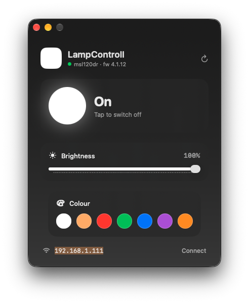
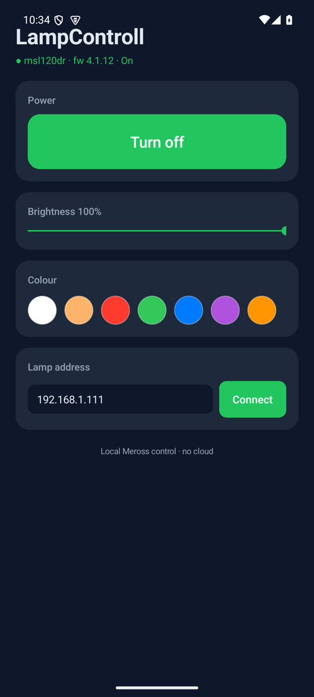

# LampControll

Local control of a **Meross MSL120DR** lamp from macOS, Android and the
command line — without the Meross cloud or a Meross account.

| macOS | Android |
| --- | --- |
|  |  |

## Status: working

The lamp is onboarded to the home Wi-Fi and controlled over the LAN:

```text
Lamp 192.168.1.111:80
  model:      msl120dr (fw 4.1.12)
  power:      on
  color:      #ffffff (rgb 16777215)
  luminance:  100
```

Verified live:

```text
$ python3 tools/lampctl.py off
power off -> verified (0)

$ python3 tools/lampctl.py on
power on -> verified (1)

$ python3 tools/lampctl.py color 00FF00
color #00ff00 -> verified (reported #00ff00)

$ python3 tools/lampctl.py color 0000FF
color #0000ff -> verified (reported #0000ff)
```

The Android app was also tested against the real lamp: tapping its green
swatch changed the lamp to `#34c759`, tapping white restored `#ffffff`.

## Apps

### macOS

`/Applications/LampControll.app` — SwiftUI, macOS 13+, ad-hoc signed.
Source: [macapp](macapp). Build with `./macapp/build.sh`.

- Power toggle
- Brightness slider
- Seven colour presets
- Live model/firmware and state
- Editable lamp IP

### Android

`LampControll.apk` — plain Java, minSdk 24, targetSdk 36, signed.
Source: [android](android). Build with `./android/build.sh`.

- Power toggle
- Brightness slider
- Seven colour presets
- Live model/firmware and state
- Editable lamp IP

Download the APK from the [latest release](https://github.com/TLSenz/lampcontroll/releases/latest).

## CLI

```sh
python3 tools/lampctl.py status
python3 tools/lampctl.py on
python3 tools/lampctl.py off
python3 tools/lampctl.py toggle
python3 tools/lampctl.py color FF8800
python3 tools/lampctl.py white
python3 tools/lampctl.py brightness 40
python3 tools/lampctl.py discover     # after a DHCP/IP change or lamp reset
```

The address and key are cached in `lamp_config.json`. If the cached address
stops responding, `lampctl` automatically rediscovers the lamp on
`192.168.1.0/24`.

## How it works

- The lamp speaks Meross's local signed JSON protocol on `POST /config`.
- Signature: `md5(messageId + key + timestamp)`.
- On this firmware `Appliance.Control.ToggleX` is authoritative for on/off;
  the `light` digest has no `onoff` field.
- RGB changes require `capacity: 7` (the ability value), not the digest's
  `capacity: 6`.
- After onboarding the local key is the empty string.

Full reverse-engineering notes, packet formats and the Wi-Fi onboarding
payload: [docs/protocol.md](docs/protocol.md).
How the SSID was discovered despite macOS privacy: [docs/discovery.md](docs/discovery.md).
Final evidence log: [docs/result.md](docs/result.md).

## Build

```sh
./macapp/build.sh                 # -> macapp/build/LampControll.app
ditto macapp/build/LampControll.app /Applications/LampControll.app

./android/build.sh                # -> android/LampControll.apk
```

The Android script uses the Android SDK directly (`aapt2`, `d8`, `apksigner`);
Gradle is not required.

## Tooling

| File | Purpose |
| --- | --- |
| `tools/lampctl.py` | Permanent CLI (on/off/color/brightness/status) |
| `tools/lamp_lan.py` | Find and control the lamp over the home LAN |
| `tools/lamp_recon.py` | AP-mode recon + control test |
| `tools/lamp_onboard.py` | Send `Appliance.Config.Wifi` from the lamp AP |
| `macapp/` | SwiftUI macOS app |
| `android/` | Android app (plain Java, no Gradle) |
| `Run-Lamp-Recon.command` | macOS helper: switch to lamp AP, recon, switch back |
| `Run-Lamp-Onboard.command` | macOS helper: onboard the lamp to the home Wi-Fi |
| `tests/mock_meross_lamp.py` | Mock lamp for offline tests |

## Recovery

- **Lamp IP changed:** `python3 tools/lampctl.py discover`
- **Lamp reset / setup AP visible again:** copy `lamp_env.example.sh` to
  `lamp_env.sh`, fill in your network/lamp details, then double-click
  `Run-Lamp-Onboard.command`. It switches the Mac to the lamp AP, sends the
  saved home Wi-Fi credentials once, switches back, and runs the LAN test.
- **Manual onboarding without disconnecting the Mac:** connect a phone to the
  lamp's setup AP, open `http://10.10.10.1/`, enter your 2.4 GHz SSID and the
  Wi-Fi password, submit, then reconnect the phone to normal Wi-Fi.

## Verification without the physical lamp

```sh
python3 tests/mock_meross_lamp.py --port 18080 &
python3 tools/lamp_recon.py --host 127.0.0.1 --port 18080 --control --color 00ff00
```

The mock validates the signature and implements `Appliance.System.All`,
`Appliance.System.Ability`, `Appliance.Control.Light`,
`Appliance.Control.ToggleX`, `Appliance.Config.WifiList` and
`Appliance.Config.Wifi`.
